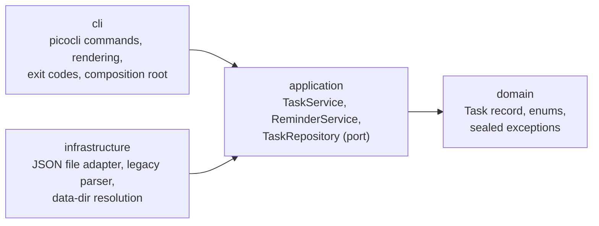

# TaskFlow
Developed by Karanveer Singh.

A fast, scriptable, crash-safe command-line task manager written in Java 21.

TaskFlow started life as a menu-driven console prototype. It has since been rebuilt around a layered
architecture, an immutable domain model, durable storage and a testable CLI. The design decisions and
their trade-offs are recorded in [`docs/adr`](docs/adr).

```text
$ taskflow add "Submit capstone report" --due tomorrow --priority high --tag school
Added #1: Submit capstone report

$ taskflow list
    ID  PRI     DUE         WHEN        TITLE
[ ]  3  HIGH    2026-11-01  overdue 3d  Pay rent #home
[ ]  1  HIGH    2026-11-05  tomorrow    Submit capstone report #school
[ ]  2  MEDIUM  2026-11-12  in 8d       Buy groceries #errand #home
[ ]  4  LOW     -                       Learn Kubernetes
4 tasks
```

*(Table output above comes from the real renderer, with a fixed date of 2026-11-04.)*

## Install and run

Requires JDK 21+.

```bash
mvn package
java -jar target/taskflow.jar --help
```

Optional alias: `alias taskflow='java -jar /path/to/taskflow.jar'`.

Docker (the image runs as a non-root user; mount a volume for your data):

```bash
docker build -t taskflow .
docker run --rm -v taskflow-data:/data taskflow list
```

## Usage

| Command | What it does |
| --- | --- |
| `add TITLE [-d DATE] [-p low\|medium\|high] [-t TAG,...]` | Add a task. `DATE` is `YYYY-MM-DD`, `today`, `tomorrow`, `+3d` or `+2w` |
| `list [--status open\|done\|all] [-t TAG] [--overdue]` | List tasks, most urgent first (alias `ls`) |
| `done ID...` / `reopen ID...` | Complete / reopen tasks (both idempotent) |
| `rm ID...` | Delete tasks (alias `delete`) |
| `remind [--within-days N]` | Overdue, due-today and soon-due tasks. Put it in your shell profile or cron |
| `import-legacy FILE [--dry-run]` | Migrate the old prototype's `tasks.txt` |

Global options: `--data-dir DIR`, `-v` / `-vv` (log verbosity), `--help`, `--version`.
`list`, `add` and `remind` accept `--json` for scripting:

```bash
taskflow list --overdue --json | jq -r '.[].title'
```

### Exit codes

| Code | Meaning |
| --- | --- |
| 0 | Success |
| 2 | Usage error (bad arguments) |
| 3 | Task not found |
| 4 | Invalid input (blank title, bad date, bad tag, ...) |
| 70 | Unexpected internal error (a bug) |
| 74 | Storage I/O error (unreadable or corrupt data file) |

### Where data lives

`--data-dir`, else `$TASKFLOW_HOME`, else `$XDG_DATA_HOME/taskflow`, else `%LOCALAPPDATA%\taskflow`,
else `~/.local/share/taskflow`. The prototype kept `tasks.txt` in the *current directory*, so running
it from another folder showed an empty list.

### Migrating from the prototype

```bash
taskflow import-legacy path/to/tasks.txt --dry-run   # preview
taskflow import-legacy path/to/tasks.txt             # import; safe to re-run
```

Bad lines are reported by line number and skipped. Duplicates (same title and due date) are skipped,
so re-running never doubles your data. The old format split on every `|`; the importer reads the
trailing fields from the right, so descriptions containing `|` survive.

## Architecture



Dependencies point inward; the domain imports nothing but the JDK.

What this buys, concretely:

* **Illegal states are unrepresentable.** `Task` is an immutable record whose constructor enforces
  every invariant (title rules, tag rules, `DONE` ⇔ has a completion time). A hand-edited data file
  goes through the same constructor on load.
* **Deterministic time.** `Clock` is injected everywhere; nothing calls `now()` statically.
* **Services never print.** They return data; the CLI renders text or JSON.
* **Exhaustive error handling.** Failures are a `sealed` exception hierarchy, mapped to exit codes
  with a `switch` that stops compiling if a new failure type is added without a mapping.
* **Storage behind a port.** The business logic is tested against an in-memory repository; the real
  file adapter must pass the same contract test.

## Reliability

* **Crash-safe writes:** temp file in the same directory → `fsync` → atomic rename. A crash leaves
  the old file or the new one, never a half-written one.
* **Concurrency-safe:** each operation is a read-modify-write under an OS file lock (across
  processes) plus a JVM lock (an OS lock cannot be taken twice inside one JVM).
* **Ids are never reused** after deletion (persisted counter).
* **Corrupt, oversized or newer-schema files are refused and never overwritten.**

## Security

Summarised here, detailed in [SECURITY.md](SECURITY.md): owner-only file permissions, terminal
escape and bidi-override characters rejected in titles on every input path, no markup injection into
coloured output, `@argfile` expansion disabled, strict schema with size and nesting limits, no task
titles in logs, non-root container, and CI with dependency review and CodeQL.

## Observability

* Logs go to **stderr** in logfmt (stdout is reserved for results so `--json` is always pipe-safe):

  ```text
  ts=2026-11-04T09:12:44.512-06:00 level=INFO logger=TaskService command=add command_id=9f3a1c02 msg="task_added id=5 priority=HIGH has_due_date=true tag_count=1"
  ```
* Every invocation carries a **correlation id** and command name (SLF4J MDC) on each line, and ends
  with a `command_finished exit_code=… duration_ms=…` summary.
* `-v` enables INFO, `-vv` DEBUG; or set `TASKFLOW_LOG_LEVEL`. Default is WARN.
* Task titles are never logged.

## Testing

* **Domain:** invariants, tag/title rules, urgency boundary tables.
* **Application:** services against an in-memory repository with a fixed clock.
* **Contract tests:** one behavioural suite run against both the in-memory double and the JSON
  adapter.
* **Adapter:** corruption, schema versioning, size limits, permissions, no leftover temp files, and
  a multi-threaded, multi-instance concurrency test.
* **CLI end-to-end:** the real command line against a real temp directory (exit codes, JSON shape,
  option inheritance, injection attempts, legacy import).
* **Gates:** JaCoCo line-coverage minimum in `mvn verify`; compiler warnings fail CI.

## Development

```bash
mvn verify           # build + tests + coverage gate + shaded jar
```

See [CONTRIBUTING.md](CONTRIBUTING.md) for development instructions.

## Known limitations / roadmap

* Single-user and local by design; no sync or encryption at rest.
* Every command reads the whole data file (O(n)); ADR-0002 describes when to move to SQLite.
* No interactive menu mode (the original prototype's UI). A `taskflow shell` REPL would be a
  natural addition on top of the existing services.
* Editing a task's title/due date after creation is not implemented yet.
